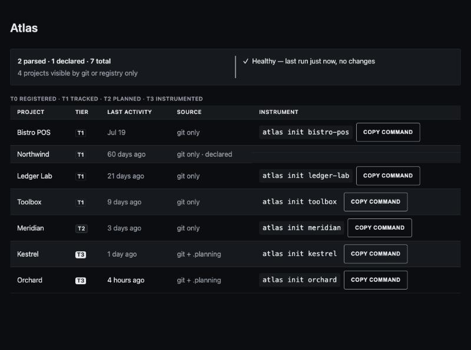
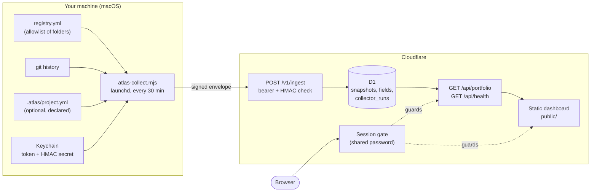

# Atlas

A small status dashboard for people who run many side projects. A local collector reads each project's git history and planning files, signs a snapshot, and pushes it to a Cloudflare Worker backed by D1. The Worker serves a read-only, password-gated table showing how recently each project moved and how much of it is instrumented.



*Seven fictional projects, collected from throwaway git repos by `npm run demo` against a local Worker and local D1. No Cloudflare account was used.*

## What it does

- **Collects locally.** `collector/atlas-collect.mjs` walks an explicit list of project folders (`collector/registry.yml`). It never crawls the disk. For each project it records the last commit date, whether a `.planning/` directory or `ROADMAP.md` + `STATE.md` exist, and any status the project declares in `.atlas/project.yml`.
- **Labels every value.** Each field in the API is `{value, confidence, source, as_of}`, so the UI can say whether something was measured, derived from presence checks, or declared by a human, and how old it is.
- **Pushes signed snapshots.** Each push carries a bearer token and an HMAC-SHA256 signature over the exact request body. Unchanged snapshots are deduplicated by content hash (the timestamp is excluded from the hash).
- **Serves a read-only view.** The Worker has no framework: two route tables, a session-cookie gate that fails closed, and static assets from `public/`.
- **Is honest about gaps.** Projects are placed in tiers (T0 registered, T1 tracked in git, T2 has roadmap and state files, T3 has a planning directory). A collector run that fails still pushes a failure envelope, and the health tile shows the real age of the last run.

## Architecture



| Part | Where | Notes |
|---|---|---|
| Worker | `src/` | `index.js` routes; `ingest.js` verifies and stores; `portfolio.js` and `health.js` read |
| Schema | `migrations/` | tenants, ingest tokens, projects, snapshots, fields, collector runs |
| Dashboard | `public/` | plain HTML and JS, no build step; `app.js` is importable in tests |
| Collector | `collector/` | Node built-ins only, no npm dependencies at run time |
| Tests | `tests/` | `vitest` in the real `workerd` runtime for the Worker, `node --test` for the collector |

## Try it locally (no Cloudflare account)

Requires Node 22 or newer (developed on Node 25) and git.

```bash
npm install
npm run migrate:local        # applies migrations to a local D1 under .wrangler/
cp .dev.vars.example .dev.vars
npm run dev                  # Worker on http://localhost:8787
```

In a second terminal:

```bash
npm run demo                 # builds fictional git repos in a temp dir, runs the collector, pushes to localhost
```

Open `http://localhost:8787/` and sign in with `ATLAS_VIEW_PASSWORD` from `.dev.vars`. If port 8787 is taken, run `npx wrangler dev --port <port>` and set `ATLAS_DEMO_URL=http://localhost:<port>` for the demo script.

## Tests

```bash
npm test          # vitest (Worker + D1 in workerd) then node --test (collector, checks)
npm run check     # the pre-push worker-name guard on its own
```

At the time of writing this runs 119 Worker tests and 160 Node tests. They cover signature verification, ingest dedup, the view gate, API shape (every leaf carries confidence, source and as_of; no absolute paths leak), the collector adapters, template merging, and the installer's plan.

## Deploy to your own Cloudflare account

Nothing below runs automatically. Placeholders are in angle brackets.

1. `npx wrangler login`
2. `npx wrangler d1 create atlas`, then put the returned id into `wrangler.jsonc` in place of `<YOUR_D1_DATABASE_ID>`.
3. `npm run migrate:remote`
4. `node scripts/bootstrap-token.mjs` mints an ingest token, an HMAC secret and a view password, stores them in the macOS Keychain and the Worker secret store, and inserts the token hash into D1. Raw values are not printed. Use `--view-password-only` to rotate only the password.
5. `node checks.mjs && npx wrangler deploy`
6. Edit `collector/registry.yml` to list your own project folders, then install the collector:

```bash
export ATLAS_INGEST_URL="https://<YOUR_WORKER_SUBDOMAIN>.workers.dev/v1/ingest"
node collector/install.mjs --dry-run   # prints the plan, writes nothing
node collector/install.mjs
launchctl bootstrap gui/$(id -u) ~/Library/LaunchAgents/com.example.atlas.collector.plist
```

Re-run `install.mjs` after any change under `collector/`; launchd runs the installed copy in `~/.atlas/`, not the checkout. Once per clone, enable the push guard: `git config core.hooksPath .githooks`.

## Declaring a project

A registered project starts as T0 or T1. `atlas init <slug>` (installed to `~/.atlas/bin/`; add that directory to your `PATH`) writes `.atlas/project.yml` and `.atlas/template.lock` into the project:

```json
{
  "identity": { "name": "orchard", "statement": "Customer ordering platform." },
  "profile": "code-project",
  "next_action": "Ship the quote request flow.",
  "health": "green, on track for the pilot"
}
```

`identity`, `profile` and `next_action` are required. Profiles are `code-project`, `ops-workstream`, `business` and `research`. A minor template bump applies automatically; a major bump or a merge conflict writes `UPGRADE-NOTES.md` and sets `needs_review` until you re-run with `--accept-major`. Use `--dry-run` first: `project.yml` is written once and never rewritten by the tool.

## Limitations

- **The collector is macOS-only.** It uses launchd for scheduling and the `security` CLI for the Keychain. The Worker and tests are portable.
- **Single tenant, single shared password.** The read side is one password gate with a signed 30-day session cookie, not per-user auth. Putting Cloudflare Access in front would be the next step.
- **Sleep drops scheduled runs.** On macOS a `StartInterval` tick that fires during sleep is dropped, so long sleeps leave gaps. The health tile shows the real age of the last run instead of hiding it.
- **Presence checks, not parsing.** Tier T2 and T3 mean "files exist", not "the plan is healthy". Nothing parses roadmap or state contents, and `planner_version` is always null.
- **Dev dependencies carry audit findings.** `npm audit` reports advisories in the dev toolchain (`wrangler`, `@cloudflare/vitest-pool-workers`, `vitest`). Nothing from there ships in the Worker bundle, but upgrade before relying on it.
- **Local dev cookie.** The session cookie is `Secure`; whether a browser stores it over plain `http://localhost` varies. Sign-in is covered by `tests/view-gate.test.js`.
- **No CI evidence yet.** `.github/workflows/test.yml` mirrors the local commands but has not run on GitHub.

## License

Apache-2.0. See [LICENSE](LICENSE).
